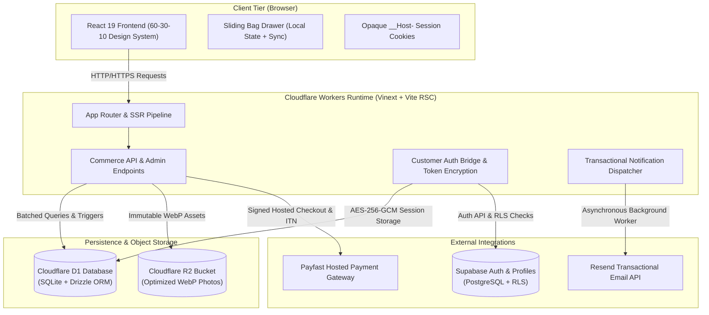

# Exclusive Apparel


Exclusive Apparel is an edge-native, full-stack apparel commerce platform catering to men, women, and kids. Architected for speed, data integrity, and high-conversion UX, the storefront pairs Next.js React Server Components with Cloudflare Workers, Cloudflare D1 serverless relational storage, Cloudflare R2 photo storage, Supabase authentication with Row-Level Security (RLS), and a resilient guest-first commerce engine.

---

## Architecture Overview


-F38020?style=flat-square)


The system is built on an edge-native, zero-cold-start architecture designed to execute on Cloudflare Workers using Vinext:



### Architectural Pillars

1. **Edge-Rendered React Server Components**: Powered by Vinext and Vite, delivering server-rendered HTML from Cloudflare edge locations with near-zero latency.
2. **ACID Relational Storage (Cloudflare D1)**: Stores product catalogues, variant SKUs, inventory counts, guest orders, payment records, and policy settings in a distributed SQLite database managed by Drizzle ORM.
3. **Atomic Stock Locking & Expiry**: Checkouts create atomic inventory reservations protected by database-level triggers to prevent overselling. Unpaid reservations automatically expire after 30 minutes, releasing inventory back to the catalogue.
4. **Resilient Guest & Customer Identity**:
   - **Guest Orders**: Private tracking via cryptographically secure SHA-256 hashed bearer tokens delivered via `__Host-` HttpOnly cookies.
   - **Registered Customers**: Supabase Auth with Row-Level Security (RLS) enforcement on customer profile tables, with access and refresh tokens stored encrypted (AES-256-GCM) in D1.
5. **High-Performance Asset Pipeline (Cloudflare R2)**: Multi-angle product photography is processed browser-side and server-side to 1600px WebP, stored in Cloudflare R2, and served with immutable cache-control headers.
6. **Transactional Notification Outbox**: Order confirmation and status update emails are queued in a database outbox and dispatched through Resend using Cloudflare Worker `ctx.waitUntil` background tasks with provider idempotency keys.

---

## 60-30-10 Design System & Aesthetics


-466144?style=flat-square)

The interface strictly adheres to the 60-30-10 color balance rule, avoiding ad-hoc rainbow colors and visual clutter:

| Proportion | Role | Hex Value | Purpose & Application |
| :--- | :--- | :--- | :--- |
| **60%** | Dominant Background | `--paper: #f7f6f2` | Primary page background, body canvas, and light negative space |
| **30%** | Structural Panels & Surfaces | `--olive: #d7deca`<br>`#e8e6de`<br>`#eeeee7`<br>`#e9ece3` | Cards, navigation bars, bag drawer, admin summary panels, table headers, and form inputs |
| **10%** | Intentional Accent | `--ink: #1c211d`<br>`#466144` | Action buttons, active navigation states, primary headings, and high-visibility focus indicators |

### Aesthetic Guidelines

- **Zero Emojis**: The user interface and technical documentation strictly prohibit emojis. All graphical indicators use lightweight, accessible SVGs.
- **Micro-Interactions Without Glow**: Purposeful hover state transitions, image zooms, and sliding panels without noisy glow effects.
- **Responsive Geometry**: Fluid typography with CSS `clamp()`, adaptable multi-column grids, and tactile touch targets (minimum 44x44px) for mobile devices.

---

## Core Features


### Storefront & Catalog
- **Audience Navigation**: Segmented collections for Men (`/collections/men`), Women (`/collections/women`), and Kids (`/collections/kids`).
- **Interactive Product Gallery**: Detail view with multi-image navigation, 1600px high-resolution zoom modal, and colour/size variant selectors.
- **Verified Garment Sizing**: Interactive size guide (`/size-guide/`) and product-level verified centimetre measurements (chest circumference, waist circumference, length, inseam, head circumference).
- **Live Inventory Feedback**: Real-time stock status per SKU variant (In Stock, Low Stock, or Sold Out) with automatic button deactivation.

### Shopping Bag & Checkout
- **Sliding Bag Drawer**: Accessible side drawer modal retaining bag state across page navigation, backed by local storage with server price re-computation.
- **Atomic Stock Reservation**: Prevents race conditions during concurrent checkouts; reserves units atomically with a 30-minute lock.
- **Flexible Delivery Selection**: Standard courier delivery, priority delivery, and regional collection options with configurable province coverage and free-shipping thresholds.
- **Payfast Hosted Payments**: Integrated adapter with SHA-512 signature hashing, ITN webhook verification, and test mode simulation.

### Customer Management & Order Tracking
- **Private Order Tracking (`/orders/`)**: Token-based access to order progression (Placed -> Paid -> Packing -> Shipped -> Delivered) without requiring registration.
- **Optional Supabase Customer Accounts (`/account/`)**: Secure sign-up, verification code input (keeping tokens out of URL histories), password reset, and profile management.
- **Exchange & Support Request System**: Order-linked size exchange requests and customer enquiries managed through dedicated workflows in the dashboard.

### Owner Administration Portal (`/admin/`)
- **Overview Dashboard**: High-level sales volume, order counts, pending fulfillment, and low-stock alerts.
- **Product & Inventory Manager**: Create and edit products, manage variants, upload WebP photography to R2, and input verified sizing charts.
- **Fulfillment Pipeline**: Transition order states, assign carrier tracking numbers, and view customer timeline events.
- **Store Configuration**: Live/Test mode toggle, delivery fee rules, free shipping thresholds, contact information, and editable statutory policies (Returns, Privacy, Terms).

---

## Directory Structure

```
exclusive-apparel/
|-- .github/
|   `-- workflows/                     CI/CD automation workflows
|-- .openai/
|   `-- hosting.json                   Hosting declarations and runtime binding specifications
|-- app/                               Next.js App Router routes and pages
|   |-- about/page.tsx                 Brand story and values
|   |-- account/page.tsx               Customer authentication, profile, and recovery
|   |-- admin/page.tsx                 Owner administration portal
|   |-- cart/page.tsx                  Full-page shopping cart view
|   |-- checkout/page.tsx              Multi-step shipping and payment checkout
|   |-- collections/                   Collection routing directory
|   |   `-- [audience]/page.tsx        Dynamic collection views (men, women, kids)
|   |-- contact/page.tsx               Customer contact form and business information
|   |-- delivery/page.tsx              Delivery options, rates, and coverage zones
|   |-- help/page.tsx                  Store FAQs and customer service
|   |-- orders/page.tsx                Private order tracking and status view
|   |-- privacy/page.tsx               Privacy policy document
|   |-- product/                       Product routing directory
|   |   `-- [slug]/page.tsx            Dynamic product detail view with gallery and sizing
|   |-- returns/page.tsx               Returns and exchange policy document
|   |-- shop/page.tsx                  Complete searchable catalogue view
|   |-- size-guide/page.tsx            Verified sizing charts and measuring instructions
|   |-- terms/page.tsx                 Terms of service document
|   |-- globals.css                    60-30-10 design system, variables, and typography
|   |-- layout.tsx                     Root layout with header, footer, bag drawer, and SEO
|   |-- loading.tsx                    Skeleton loading states for route transitions
|   |-- not-found.tsx                  Branded 404 error page
|   |-- page.tsx                       Home page with hero photography, collections, and featured items
|   |-- robots.ts                      Edge-rendered robots.txt generator
|   `-- sitemap.ts                     Dynamic XML sitemap generator
|-- build/
|   |-- sites-vite-plugin.ts           Custom Vite plugin for Cloudflare Worker compilation
|   `-- sites-worker.ts                Worker edge entry point handling requests and SSR
|-- components/                        Modular UI components
|   |-- admin-dashboard.tsx            Owner administration tabs, forms, and tables
|   |-- bag-drawer.tsx                 Sliding shopping bag side drawer
|   |-- cart-view.tsx                  Cart page line items and order summary
|   |-- catalogue.tsx                  Catalog grid with filtering and pagination
|   |-- checkout-view.tsx              Checkout form, address fields, and delivery options
|   |-- collection-photography.tsx     Collection imagery and lifestyle banners
|   |-- contact-form.tsx               Customer enquiry submission form
|   |-- customer-account.tsx           Sign-in, registration, and OTP verification interface
|   |-- exchange-request.tsx           Order-linked garment exchange submission form
|   |-- footer.tsx                     Site footer with navigation, policies, and copyright
|   |-- header.tsx                     Sticky navigation header with brand crown and bag counter
|   |-- order-status.tsx               Order fulfillment progression timeline
|   |-- product-card.tsx               Product thumbnail with swatch indicators and stock badges
|   |-- product-gallery.tsx            Multi-angle photo viewer with high-res zoom modal
|   |-- product-options.tsx            Variant selector, size buttons, and bag action
|   |-- shop-intro.tsx                 Catalog header and search input
|   |-- size-chart-editor.tsx          Admin interface for entering verified measurements
|   |-- size-table.tsx                 Customer-facing dimension table
|   |-- store-provider.tsx             React context for bag management and notification toasts
|   |-- structured-data.tsx            JSON-LD schema markup for SEO
|   |-- support-page.tsx               Structured policy template layout
|   `-- web-vitals.tsx                 Core Web Vitals browser telemetry collector
|-- db/
|   `-- schema.ts                      Drizzle ORM SQLite schema definitions for D1
|-- docs/                              Technical documentation and specifications
|   |-- COMMERCE.md                    Commerce engine configuration, stock, and payment rules
|   |-- DEPENDENCY-AUDIT.json          Machine-readable security vulnerability audit log
|   |-- LAUNCH.md                      Production readiness and deployment checklist
|   |-- PLAN.md                        Roadmap, implemented features, and operational gates
|   |-- PRODUCT-PHOTOS.md              Photography standards and image processing pipeline
|   |-- SECURITY.md                    Security controls, authentication rules, and RLS specs
|   `-- SEO.md                         Search engine optimization strategy and metadata standards
|-- drizzle/                           Drizzle SQL database migrations
|   |-- meta/                          Migration journal metadata
|   |-- 0000_windy_blob.sql            Initial commerce schema (products, orders, variants)
|   |-- 0001_inventory-safety.sql      Triggers preventing negative stock and invalid transitions
|   |-- 0002_parched_fantastic_four.sql Verified size charts and delivery rate settings
|   |-- 0003_flawless_kingpin.sql      Customer support requests and size exchange tables
|   `-- 0004_retire-unphotographed-products.sql Migration retiring products without photography
|-- lib/                               Shared utilities, models, and types
|   |-- api.ts                         Client-side API fetch wrappers
|   |-- apparel-photo-assets.json      Apparel photo mappings and metadata
|   |-- availability.mjs               Inventory state calculations and out-of-stock helpers
|   |-- cap-photo-assets.json          Cap photo assets and colourways
|   |-- cart.mjs                       Cart calculations, line item merges, and price validation
|   |-- catalog.ts                     Server-side catalog query helper
|   |-- commerce-model.mjs             Business domain rules, order states, and validation logic
|   |-- metadata.ts                    Open Graph, Twitter, and canonical metadata definitions
|   |-- policies.ts                    Default statutory store policies and draft text
|   |-- product-photography.ts         Product image resolution and fallback handling
|   |-- products.json                  Starter product catalog data
|   |-- retired-products.ts            Guard logic blocking withdrawn product variants
|   |-- seo.mjs                        Slug normalization, canonical formatting, and JSON-LD
|   `-- store-types.ts                 TypeScript interfaces for commerce entities
|-- public/                            Static assets and public web files
|   |-- photos/                        High-resolution product and lifestyle photography
|   |-- products/                      Product SVG illustrations and WebP thumbnails
|   |-- favicon.ico                    Site browser icon
|   |-- logo.webp                      Brand crown logo
|   `-- manifest.webmanifest           Progressive web application manifest
|-- scripts/                           Build, maintenance, and deployment scripts
|   |-- connector-preview/             Local development proxy and host bindings
|   |-- finalize-worker.mjs            Build step finalizing Cloudflare Worker output
|   |-- optimize-store-images.mjs      Sharp image compression script
|   |-- patch-lucide.mjs               Hotfix script for upstream icon export typos
|   |-- run-framework.mjs              Vinext development server runner
|   `-- sites-env.mjs                  Environment loader for Wrangler and D1 CLI
|-- server/                            Cloudflare Worker server endpoints
|   |-- catalogue.ts                   Catalogue query and cache handler
|   |-- commerce.ts                    Checkout processing, orders, and payment webhooks
|   |-- customer-auth.ts               Supabase auth bridging, session hashing, and encryption
|   |-- image-validation.ts            Upload validation (JPEG/PNG/WebP, max 5MB, dimension caps)
|   |-- request-body.ts                Bounded streaming request parser
|   |-- seo-resources.ts               Sitemap and robots.txt edge responders
|   `-- seo.ts                         Server metadata extraction
|-- supabase/
|   `-- migrations/                    PostgreSQL migrations for customer profiles and RLS
|-- tests/                             Test suites (ESM and TypeScript)
|   |-- cart.test.mjs                  Cart merging, item capping, and pricing tests
|   |-- commerce-api.test.ts           API authorization, stock rollback, and checkout tests
|   |-- commerce-model.test.mjs        Domain validation, shipping thresholds, and sizing tests
|   |-- customer-auth.test.ts          Customer registration, encryption, and RLS tests
|   |-- customer-rls.sql               Live Postgres RLS policy verification tests
|   `-- seo.test.mjs                   Metadata, canonical route, and JSON-LD schema tests
|-- .env.example                       Environment variable reference template
|-- .gitignore                         Git exclusion rules (ignoring node_modules, dist, .agents)
|-- cloudflare-env.d.ts                Cloudflare Workers environment type definitions
|-- drizzle.config.ts                  Drizzle Kit configuration for D1 migrations
|-- package.json                       Project manifest, scripts, and dependencies
|-- tsconfig.json                      TypeScript compiler configuration
`-- vite.config.ts                     Vite build configuration
```

---

## Security Architecture & Controls


| Layer | Implementation & Safeguards |
| :--- | :--- |
| **Authentication & Tokens** | Provider JWTs never reach browser client code. Sessions use opaque, random `__Host-` cookies with `HttpOnly`, `Secure`, `SameSite=Lax`, and 7-day expiry. Provider access/refresh tokens are encrypted with AES-256-GCM in D1. |
| **Row-Level Security** | Supabase customer profiles enforce PostgreSQL Row-Level Security (`ENABLE ROW LEVEL SECURITY` and `FORCE ROW LEVEL SECURITY`). Profile creation triggers execute in a private, unexposed schema. |
| **Database Protection** | Parameterized SQL across all Cloudflare D1 interactions. Negative inventory quantities are rejected via database triggers (`0001_inventory-safety.sql`). |
| **Admin Route Isolation** | Owner routes (`/admin`) require both edge identity verification and server-side membership validation against the `ADMIN_EMAILS` secret. |
| **Upload Sanitization** | Image uploads restricted to owner sessions, capped at 5 MB, validated against JPEG/PNG/WebP magic byte signatures, capped at 10,000px per dimension, and converted to WebP via Sharp. |
| **Payment Integrity** | Payfast ITN webhooks validate configured signatures, merchant identifiers, payment amounts against database records, and deduplicate notification IDs. |
| **Rate Limiting** | Persistent D1 rate-limiting on auth attempts, verification code resends, checkout submissions, order lookups, and support forms. |

---

## Development & Operations

### Prerequisites
- Node.js 22.13.0 or higher
- npm 10.0.0 or higher

### Installation

```bash
git clone git@github.com:thulanesigasa/exclusive-apparel.git
cd exclusive-apparel
npm ci
```

### Environment Configuration

Copy `.env.example` to create your local runtime variables (never commit `.env` files):

```bash
cp .env.example .env
```

Key environment variables:
- `STORE_MODE`: Run in `test` (default) or `live` mode.
- `ADMIN_EMAILS`: Comma-separated list of authorized administrator email addresses.
- `AUTH_SESSION_KEY`: 64-character hex string (32 bytes) for AES-256-GCM token encryption.
- `PAYFAST_MERCHANT_ID`, `PAYFAST_MERCHANT_KEY`, `PAYFAST_PASSPHRASE`: Payfast credentials.
- `RESEND_API_KEY`, `EMAIL_FROM`: Resend credentials for transactional email dispatch.
- `SUPABASE_URL`, `SUPABASE_ANON_KEY`: Supabase credentials for customer accounts.

### Available Scripts

| Command | Purpose |
| :--- | :--- |
| `npm run dev` | Launch the local development server via Vinext on `http://localhost:5174` |
| `npm run build` | Compile the application for Cloudflare Workers (`dist/server` and `dist/client`) |
| `npm run typecheck` | Execute TypeScript compiler check without emitting output |
| `npm test` | Run the complete automated test suite (35 unit and integration tests) |
| `npm run db:generate` | Generate append-only Drizzle SQL migrations for Cloudflare D1 |
| `npm run images:optimize` | Optimize and compress catalog images to WebP format using Sharp |
| `npm run postinstall` | Automatically apply icon export compatibility patches |

### Applying Local Database Migrations

When developing with local Cloudflare D1 emulators via Wrangler:

```bash
npm run build
node --import ./scripts/sites-env.mjs ./node_modules/wrangler/bin/wrangler.js d1 execute DB --local --config dist/server/wrangler.json --persist-to .wrangler/state --file drizzle/0000_windy_blob.sql
node --import ./scripts/sites-env.mjs ./node_modules/wrangler/bin/wrangler.js d1 execute DB --local --config dist/server/wrangler.json --persist-to .wrangler/state --file drizzle/0001_inventory-safety.sql
node --import ./scripts/sites-env.mjs ./node_modules/wrangler/bin/wrangler.js d1 execute DB --local --config dist/server/wrangler.json --persist-to .wrangler/state --file drizzle/0002_parched_fantastic_four.sql
node --import ./scripts/sites-env.mjs ./node_modules/wrangler/bin/wrangler.js d1 execute DB --local --config dist/server/wrangler.json --persist-to .wrangler/state --file drizzle/0003_flawless_kingpin.sql
node --import ./scripts/sites-env.mjs ./node_modules/wrangler/bin/wrangler.js d1 execute DB --local --config dist/server/wrangler.json --persist-to .wrangler/state --file drizzle/0004_retire-unphotographed-products.sql
```

### Automated Verification

The continuous integration test suite validates:
- Cart line-item merging, quantity boundaries, and server-side pricing.
- Atomic stock reservations, concurrent purchase prevention, and rollback safety.
- Expiration of unpaid checkout reservations after 30 minutes.
- Payfast signature verification and fail-closed security when credentials are omitted.
- Guest bearer token isolation and HttpOnly cookie security.
- Supabase customer authentication, token encryption, and session invalidation.
- SEO canonical URLs, absolute HTTPS redirects, and valid JSON-LD schema generation.

---

## License

Private and proprietary. All rights reserved by Exclusive Apparel.
